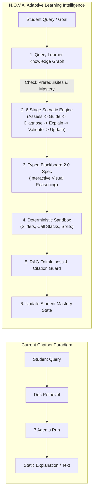
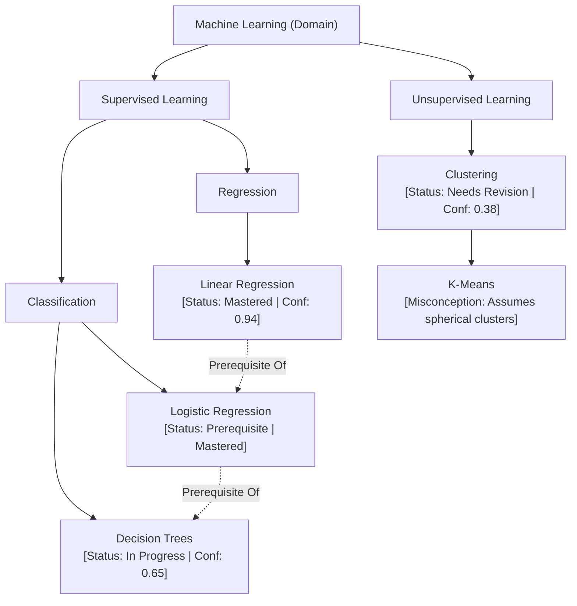
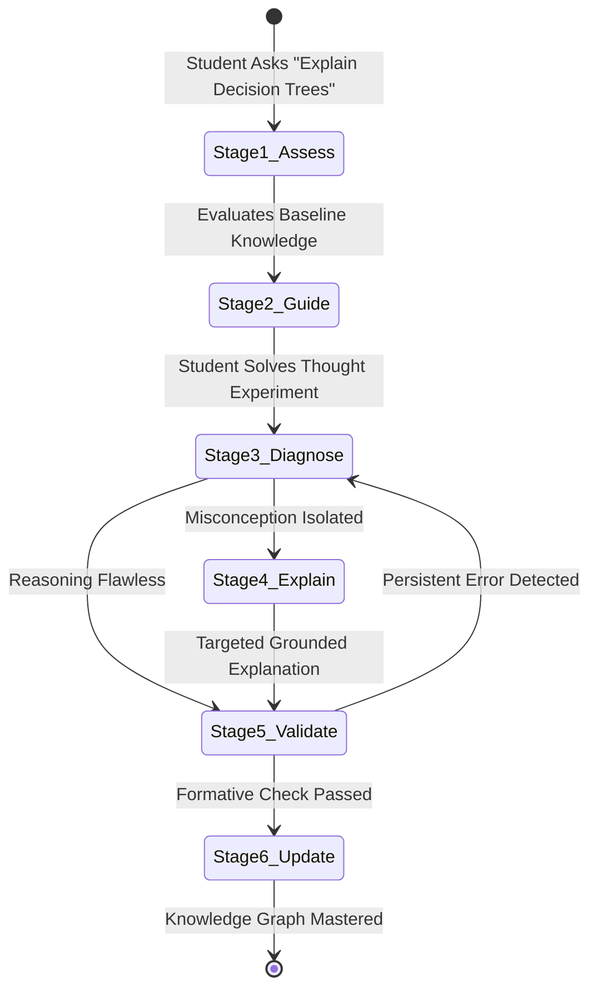
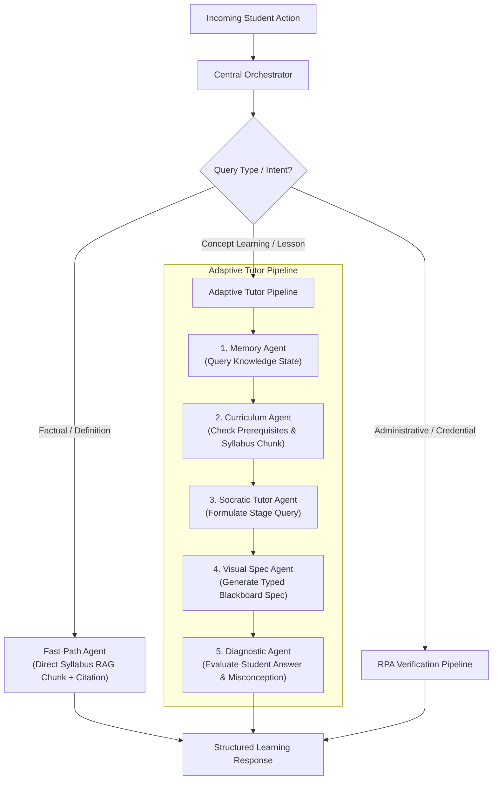

# N.O.V.A. 2.0 Architectural Blueprint: Transitioning to an Adaptive Learning Intelligence System

> **Strategic North Star:**  
> *"N.O.V.A. is not a chatbot swarm. It is an **Adaptive Learning Intelligence Ecosystem** that models what students know, isolates what they misunderstand, and actively teaches through syllabus-grounded Socratic inquiry and interactive visual reasoning."*

---

## 1. Paradigm Shift: Multi-Agent Chatbot vs. Learning Intelligence System



| Dimension | Legacy Chatbot Paradigm | N.O.V.A. 2.0 Learning Intelligence |
|---|---|---|
| **Primary Goal** | Generate an accurate text response | Diagnose root cognitive gaps and advance conceptual mastery |
| **Context Model** | Flat conversation history (chat messages) | **Dynamic Learner Knowledge Graph** (concepts, prerequisites, confidence) |
| **Pedagogical Flow** | Direct answer or static prompt loop | **6-Stage Socratic Inquiry** (Assess $\rightarrow$ Guide $\rightarrow$ Diagnose $\rightarrow$ Explain $\rightarrow$ Validate $\rightarrow$ Update) |
| **Visual Delivery** | Static diagram / markdown text | **Interactive Visual Reasoning Canvas** (manipulable models, sliders, step execution) |
| **Agent Collaboration**| Unstructured multi-agent invocation | **Typed I/O Contracts** with conditional short-circuit routing |
| **Validation** | String similarity or generic guardrails | **Formal RAG Evaluation** (Recall@K, Faithfulness, Page-Level Provenance) |

---

## 2. Technical Architecture & Component Specifications

### 2.1 Pillar 1: The Learner Knowledge Graph (LKG) Engine
Instead of treating each chat session as isolated, N.O.V.A. maintains an institutional knowledge graph per course, overlaid with the student's mastery profile.



#### Data Model (PostgreSQL / Relational Graph Representation):
```sql
-- Concept Nodes per Course Syllabus
CREATE TABLE course_concepts (
    id UUID PRIMARY KEY DEFAULT gen_random_uuid(),
    course_id UUID REFERENCES courses(id) ON DELETE CASCADE,
    name VARCHAR(255) NOT NULL,
    slug VARCHAR(100) NOT NULL,
    description TEXT,
    difficulty_tier INT DEFAULT 1,
    syllabus_week INT,
    created_at TIMESTAMP WITH TIME ZONE DEFAULT NOW()
);

-- Prerequisite Dependencies (Directed Edges)
CREATE TABLE concept_dependencies (
    prerequisite_id UUID REFERENCES course_concepts(id) ON DELETE CASCADE,
    target_id UUID REFERENCES course_concepts(id) ON DELETE CASCADE,
    weight FLOAT DEFAULT 1.0, -- Criticality of prerequisite
    PRIMARY KEY (prerequisite_id, target_id)
);

-- Learner Mastery State
CREATE TABLE student_knowledge_states (
    id UUID PRIMARY KEY DEFAULT gen_random_uuid(),
    student_id UUID REFERENCES users(id) ON DELETE CASCADE,
    concept_id UUID REFERENCES course_concepts(id) ON DELETE CASCADE,
    mastery_status VARCHAR(50) DEFAULT 'unseen', -- unseen, introduced, practicing, mastered, needs_revision
    confidence_score FLOAT DEFAULT 0.0, -- 0.0 to 1.0
    assessments_count INT DEFAULT 0,
    consecutive_correct INT DEFAULT 0,
    last_evaluated_at TIMESTAMP WITH TIME ZONE DEFAULT NOW(),
    active_misconceptions JSONB DEFAULT '[]'::jsonb,
    UNIQUE (student_id, concept_id)
);
```

#### How the Engine Operates:
1. **Prerequisite Gating**: Before teaching *Decision Trees*, the system inspects the student's state on *Classification Basics* and *Information Entropy*. If prerequisites are unmastered, N.O.V.A. halts and flags the foundational deficit.
2. **Dynamic Decay & Reinforcement**: Confidence scores decay over time unless reinforced through spaced formative checks.
3. **Misconception Tagging**: When a student fails a diagnostic check, the exact misconception slug (e.g., `MISCONCEPTION_KMEANS_NON_CONVEX`) is bound to the concept node.

---

### 2.2 Pillar 2: 6-Stage Adaptive Socratic Teaching Engine

Instead of immediately generating a lengthy lecture script when a student asks: *"Explain Decision Trees"*, N.O.V.A. executes a state-machine pedagogical pipeline:



1. **Stage 1 — Assess (Baseline Probe)**:
   * *N.O.V.A.:* *"Before we construct a tree, tell me: how would you intuitively split a group of students into 'Pass' or 'Fail' based on attendance and study hours?"*
2. **Stage 2 — Guide (Interactive Guided Inquiry)**:
   * Provides a concrete scenario: *"Suppose student A has 85% attendance but 1 study hour, and student B has 40% attendance and 10 study hours. Which feature gives you the cleanest first separation?"*
3. **Stage 3 — Diagnose (Misconception Isolation)**:
   * Student answers incorrectly: *"Attendance is always best because higher attendance means you must pass."*
   * Diagnostic Engine identifies cognitive flaw: **Conflating correlation with a deterministic threshold rule; ignoring multivariate decision boundaries.**
4. **Stage 4 — Explain (Targeted Grounded Explanation)**:
   * Retrieves syllabus slide from CS-401 (Slide 14, "Gini Impurity & Information Gain").
   * Explains *why* the mathematical calculation of impurity prevents single-feature bias.
5. **Stage 5 — Validate (Verification Check)**:
   * Poses an isomorphic, non-identical problem to verify transfer of understanding: *"If a split leaves 50% pass and 50% fail in both child nodes, did our Information Gain increase or stay zero?"*
6. **Stage 6 — Update (Knowledge Graph Sync)**:
   * Updates `student_knowledge_states`: Marks `decision_trees` status $\rightarrow$ `practicing`, records `confidence_score` $= 0.75$, clears previous misconception tag.

---

### 2.3 Pillar 3: Dynamic Blackboard 2.0 (Interactive Visual Reasoning Canvas)

The AI generates a **strict, typed visual specification** that is validated by a Zod/Pydantic schema before drawing. The frontend renders **deterministic, interactive manipulables**:

```json
{
  "canvas_type": "interactive_manipulable",
  "topic": "linear_regression",
  "engine": "coordinate_plane_v1",
  "initial_state": {
    "points": [
      {"x": 1, "y": 2}, {"x": 2, "y": 2.8}, {"x": 3, "y": 3.6},
      {"x": 4, "y": 4.5}, {"x": 5, "y": 5.1}
    ],
    "slope": 0.5,
    "intercept": 1.0,
    "target_slope": 0.78,
    "target_intercept": 1.1
  },
  "controls": [
    {
      "id": "slider_m",
      "type": "slider",
      "label": "Slope (m)",
      "min": -2.0,
      "max": 3.0,
      "step": 0.05,
      "bind_to": "slope"
    },
    {
      "id": "slider_c",
      "type": "slider",
      "label": "Intercept (c)",
      "min": -5.0,
      "max": 5.0,
      "step": 0.1,
      "bind_to": "intercept"
    }
  ],
  "live_metrics": {
    "mse": "calc_mean_squared_error(points, slope, intercept)",
    "equation_display": "y = {slope}x + {intercept}"
  },
  "pedagogical_challenge": {
    "prompt": "Adjust slope and intercept to minimize Mean Squared Error (MSE < 0.08). Observe how residuals shrink.",
    "success_threshold": {"metric": "mse", "operator": "<=", "value": 0.08}
  }
}
```

#### Specialized Interactive Visual Engines:
1. **Coordinate Plane Engine**: Sliders dynamically recalculate residuals, regression line, and MSE loss in real-time.
2. **Tree Splitter Engine**: Allows student to click nodes and choose thresholds to visually see how Gini impurity drops.
3. **Memory & Call-Stack Engine**: Step-through buttons execute recursive code line-by-line, highlighting activation frames pushed/popped from the stack.
4. **Relational Algebra Engine**: Interactive Venn diagrams and table joining animations for SQL queries.

---

### 2.4 Pillar 4: Lean Orchestrator 2.0 with Typed Contracts

Instead of arbitrarily spinning up 7 agents for every prompt, the **Central Orchestrator** operates with short-circuit policies and explicit typed contracts.



#### Typed Agent Contracts (Example):
```python
class TutorInputContract(BaseModel):
    student_id: UUID
    course_id: UUID
    target_concept: str
    learner_history: List[str]
    prerequisites_met: bool
    current_misconceptions: List[str]
    syllabus_context_chunks: List[str]

class TutorOutputContract(BaseModel):
    socratic_stage: Literal["assess", "guide", "diagnose", "explain", "validate"]
    pedagogical_prompt: str
    simplified_question: Optional[str]
    visual_specification: Optional[Dict[str, Any]]
    confidence_score: float = Field(ge=0.0, le=1.0)
    requires_human_escalation: bool
```

---

### 2.5 Pillar 5: RAG Grounding & Evaluation Pipeline

To ensure absolute institutional credibility, every RAG retrieval and generation step is quantitatively audited:

| Metric | Target | Measurement Method | Failure Action |
|---|---|---|---|
| **Retrieval Recall@4** | $\ge 0.92$ | Synthetic test-question chunk retrieval evaluation | Trigger chunk boundary adjustments or semantic query rewriting |
| **Faithfulness Score** | $\ge 0.95$ | Cross-encoder check verifying every generated statement has direct source chunk evidence | Intercept output; route to human escalation desk |
| **Citation Precision** | 100% | Every paragraph mapped to explicit page number and lecture slide ID | Reject generation; fall back to strict quote extraction |
| **Hallucination Rate** | $< 2\%$ | Contradiction detection against institutional corpus | Suppress response; emit uncertainty warning to student |

---

## 3. High-Impact Features to Add

1. **Learning Analytics Intelligence**:
   * Visual student dashboard showing mastery progression bars, recurring misconceptions, learning velocity, and upcoming weak topic recommendations.
2. **Faculty Intelligence Portal**:
   * Cohort-level heatmaps showing which concepts across the entire class have the highest misconception density, allowing the professor to adjust the next day's live lecture.
3. **Interactive Code Playground**:
   * Embedded WebAssembly (Pyodide) sandbox in the blackboard allowing students to write, run, and step through Python code while Dr. Nova provides line-by-line feedback.
4. **Prerequisite Intelligence Navigator**:
   * Visual dependency tree showing the student exactly what foundational concepts they need to unlock before advancing to higher-level modules.

---

## 4. Architectural Anti-Patterns to Strictly Avoid

* ❌ **Do NOT add agents for vanity**: Having 10+ agents adds orchestration latency, increases token cost, and multiplies failure points. Only use agents with discrete, typed responsibilities.
* ❌ **Do NOT invoke full swarms for simple lookups**: An inquiry like *"What date is the mid-term?"* or *"Define polymorphism"* should resolve via Fast-Path RAG without triggering the pedagogical Socratic cycle.
* ❌ **Do NOT rely on LLM code generation for visuals**: Never ask an LLM to generate raw JavaScript or arbitrary SVG code directly; it is brittle and prone to syntax bugs. Always use **typed visual specs validated against deterministic frontend renderers**.
* ❌ **Do NOT execute unsupervised RPA actions**: Robotic administrative syncs (e.g. updating student grade records or campus ERP databases) must require cryptographic role tokens and faculty audit logs.
