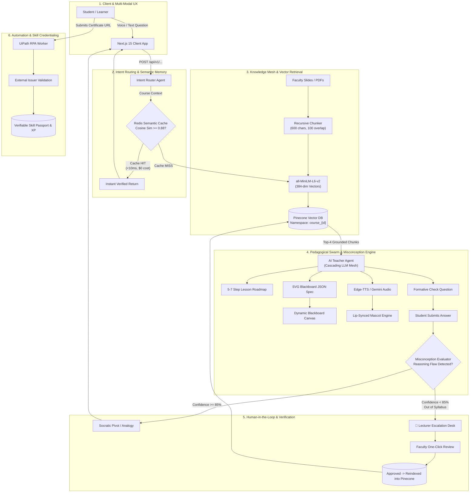

# Detailed Project Report (DPR)
## N.O.V.A. — Next-Gen Multi-Agent AI Academic & Virtual Teaching Swarm

**Document Code:** DPR-NOVA-2026-V1  
**Lead Architect & Author:** Arjun R & Team N.O.V.A.  
**Version:** 2.0 — Interview, Defense & Engineering Edition  
**Companion Guide:** [Master Interview & Defense Guide](file:///home/arjun/.gemini/antigravity/brain/f7e9eee7-2964-4ebe-8353-e2589d360632/NOVA_Interview_and_Defense_Guide.md)  
**Motto:** *No Question Left Behind.*  
**Tagline:** *Beyond Scores. Towards Understanding.*  

---

## 1. Executive Summary & Problem-Solution Fit

### 1.1 The Academic Dilemma
Higher education, especially in undergraduate Computer Science and Engineering, suffers from the **"Silent Classroom" problem**:
* Students hesitate to ask foundational questions during lectures due to peer pressure, fear of judgment, or limited class time.
* Generic LLMs (ChatGPT, Claude) lack awareness of specific lecturer syllabi, course slide decks, and exam requirements; they often hallucinate or bypass learning by handing over direct answers.
* Lecturers are overwhelmed with repetitive administrative inquiries and the same foundational conceptual doubts repeated across office hours and emails.

### 1.2 N.O.V.A. Solution Architecture
N.O.V.A. is engineered as a **pedagogical companion** operating on an autonomous multi-agent swarm architecture:
1. **Zero-Hallucination Agentic RAG**: Vector searches are strictly isolated per course namespace in Pinecone (`course_{id}`), ensuring answers are derived directly from lecturer-approved textbooks and lecture slides.
2. **Socratic Misconception Loop**: When students submit flawed answers, N.O.V.A. diagnoses root cognitive gaps (e.g. confusing reference assignment with deep copying) and shifts pedagogical strategies (Socratic inquiry, physical analogies, first principles) rather than spoon-feeding answers.
3. **Multi-Modal Visual Blackboard**: Real-time structured generation of dynamic SVG chalkboard diagrams, call-stack visualizers, and mathematical notation paired with Dr. Nova & Prof. Orion voice personas.
4. **Redis Semantic Cosine Cache**: High-performance semantic vector caching ($\text{Cosine} \ge 0.88$) intercepts duplicate or rephrased queries across the student cohort, providing sub-10ms responses at zero LLM token cost.
5. **UiPath Robotic Process Automation (RPA)**: Scrapes, verifies, and audits external credentials (UiPath Academy diplomas, certifications) to maintain a verifiable digital Skill Passport and XP ledger.

---

## 2. End-to-End Architectural Flowchart

---

## 3. Mathematical & Algorithmic Formulations

### 3.1 Cosine Semantic Similarity Cache
When a student query $q_{\text{new}}$ is submitted, its 384-dimensional dense vector $\mathbf{v}_{\text{new}}$ is computed and evaluated against cached query vectors $\mathbf{v}_{\text{cached}}$:

$$\text{Similarity}(\mathbf{v}_{\text{new}}, \mathbf{v}_{\text{cached}}) = \frac{\mathbf{v}_{\text{new}} \cdot \mathbf{v}_{\text{cached}}}{\|\mathbf{v}_{\text{new}}\|_2 \|\mathbf{v}_{\text{cached}}\|_2} = \frac{\sum_{i=1}^{384} v_{\text{new}, i} \cdot v_{\text{cached}, i}}{\sqrt{\sum_{i=1}^{384} v_{\text{new}, i}^2} \cdot \sqrt{\sum_{i=1}^{384} v_{\text{cached}, i}^2}}$$

* **Decision Boundary**:
  $$\text{Response} = \begin{cases} 
  \text{Redis Cache Hit} & \text{if } \text{Similarity} \ge 0.88 \\
  \text{Pinecone RAG + LLM Inference} & \text{if } \text{Similarity} < 0.88
  \end{cases}$$

### 3.2 Recursive Document Chunking Strategy
Lecture documents (PDFs, PPT exports, DOCX) are tokenized using recursive boundary slicing:
* **Chunk Length ($L$):** 600 characters
* **Overlap ($\Delta$):** 100 characters
* **Preservation Rule:** Mathematical theorems and code blocks are bounded to avoid split context:
  $$\text{Chunk}_k = [\text{pos}_k, \text{pos}_k + L], \quad \text{pos}_{k+1} = \text{pos}_k + (L - \Delta)$$

### 3.3 Cascading LLM Mesh Priority
To guarantee 99.9% uptime and handle rate-limits (HTTP 429), inference is dispatched down a prioritized chain:
$$\text{Provider Sequence} = [\text{NVIDIA Nemotron 550B} \longrightarrow \text{Groq Llama 3.1 8B} \longrightarrow \text{OpenRouter 70B} \longrightarrow \text{Gemini/OpenAI}]$$

---

## 4. Interview & Viva Cheat Sheet (Core Takeaways)

For a complete question-by-question breakdown, open:  
👉 **[NOVA_Interview_and_Defense_Guide.md](file:///home/arjun/.gemini/antigravity/brain/f7e9eee7-2964-4ebe-8353-e2589d360632/NOVA_Interview_and_Defense_Guide.md)**

* **Why FastAPI?** Native asynchronous I/O event loop prevents worker blocking during 1–3s LLM and vector database requests.
* **Why all-MiniLM-L6-v2?** 384-dimensional embeddings consume 4x less memory than OpenAI embeddings, execute on CPU in <80ms, and maintain high retrieval precision.
* **How are cold starts avoided?** Models are pre-warmed in RAM via FastAPI’s ASGI `lifespan` handler before incoming HTTP requests are served.
* **How does Human-in-the-Loop work?** Low confidence answers (<85%) generate an `Escalation` record that alerts faculty; once approved by the lecturer, the answer is re-indexed into Pinecone as permanent institutional memory.

---

## 5. Strategic Transformation: Evolving to an Adaptive Learning Intelligence System

> **Vision:** Move N.O.V.A. from an aggregate multi-agent chatbot into an **Adaptive Learning Intelligence Ecosystem** that models what students know, isolates what they don't, and dynamically teaches them through structured Socratic inquiry and interactive visual reasoning.

See full blueprint: [ADAPTIVE_INTELLIGENCE_BLUEPRINT.md](file:///home/arjun/Desktop/N.O.V.A/nova-platform/ADAPTIVE_INTELLIGENCE_BLUEPRINT.md)

### Key Architectural Pillars:
1. **Learner Knowledge Graph (LKG)**: Tracks concept mastery (`unseen`, `introduced`, `practicing`, `mastered`, `needs_revision`), prerequisite dependencies, confidence decay, and persistent cognitive flaws.
2. **6-Stage Socratic Teaching Engine**:
   - `Stage 1 — Assess`: Establish learner baseline.
   - `Stage 2 — Guide`: Poses leading scenario/thought experiment.
   - `Stage 3 — Diagnose`: Isolate root cognitive misconception.
   - `Stage 4 — Explain`: Grounded explanation from institutional syllabus slides.
   - `Stage 5 — Validate`: Isomorphic test question verifying concept transfer.
   - `Stage 6 — Update`: Synchronize state and confidence into the Knowledge Graph.
3. **Dynamic Blackboard 2.0 (Interactive Visual Reasoning Canvas)**:
   - Replaces static images with interactive manipulables (e.g., dynamic linear regression line sliders, decision tree splitters, recursive call-stack execution, and relational database table joins).
   - Generates typed visual specs validated against deterministic schemas.
4. **Lean Orchestrator 2.0 with Typed Contracts**:
   - Prevents running expensive full-swarm loops for simple definition lookups (Fast-Path RAG).
   - Enforces Pydantic/Zod typed I/O contracts across all agent nodes.
5. **RAG Grounding & Evaluation Pipeline**:
   - Quantified metrics: Retrieval Recall@4 ($\ge 0.92$), Faithfulness ($\ge 0.95$), Citation Precision ($100\%$), and Hallucination suppression ($< 2\%$).

---

## 6. Implementation Progress Update (Milestone 2 Active)

### What Was Just Added & Integrated:
1. **Learner Knowledge Graph (LKG) Database Core**:
   - `CourseConcept` & `ConceptDependency` tables creating syllabus concept topologies.
   - `StudentKnowledgeState` persistent mastery lifecycle (`unseen` -> `introduced` -> `practicing` -> `mastered` -> `needs_revision`).
   - Alembic migration `f8a1b2c3d4e5_add_knowledge_graph_tables.py` committed.
2. **Prerequisite Gating & Graph Service**:
   - `KnowledgeGraphService.check_prerequisites_met` blocks advanced lessons if foundational prerequisites lack $\ge 0.70$ confidence.
   - Socratic interactions automatically update consecutive streaks and confidence scores (+0.15 on correct, -0.20 on incorrect) and attach active misconception tags.
3. **Interactive Blackboard 2.0 Manipulables**:
   - Built `InteractiveManipulable.tsx` rendering reactive coordinate planes with dynamic sliders (slope $m$, intercept $c$) and real-time residual/loss recalculation.
   - Mounted dynamically into `SVGBlackboard.tsx`.
4. **Complete Technical History**:
   - Maintained in [DEVELOPMENT_LOG.md](file:///home/arjun/Desktop/N.O.V.A/nova-platform/DEVELOPMENT_LOG.md).
