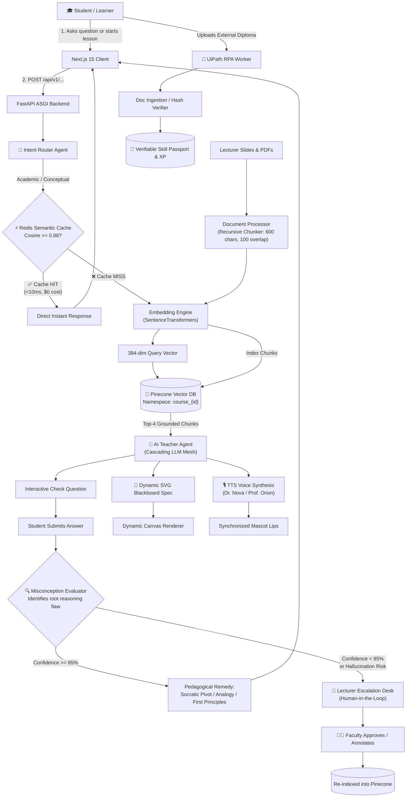

# N.O.V.A. — Master Interview & System Defense Guide (Complete DPR)
**Next-gen Optimized Virtual Assistant | Autonomous Academic Intelligence Swarm**

> **How to use this guide:**  
> This document is designed for technical interviews, architectural defense, project presentations, and viva examinations. It demystifies the entire system from first principles: **why** every decision was made, **how** data flows under the hood, **where** bottlenecks occur, mathematical formulations, architectural trade-offs, and how to answer the toughest interview questions confidently.

---

## 1. The 30-Second Elevator Pitch & Core Narrative

> *"N.O.V.A. is an autonomous multi-agent academic intelligence and virtual teaching platform engineered to solve the 'silent classroom' problem. Unlike generic LLM chatbots that hallucinate or provide out-of-syllabus answers, N.O.V.A. acts as an institutional teaching companion. It combines **Namespace-Isolated Agentic RAG** grounded strictly in lecturer-approved notes with an **Adaptive Misconception Evaluator Loop** that switches pedagogical strategies (Socratic inquiry, analogies, first principles) rather than giving away answers. It delivers explanations through a **live vector SVG Blackboard** and **synchronized audio personas**, cuts LLM costs by ~40-60% via a **cosine semantic cache in Redis**, automates external certificate validation via **UiPath RPA workers**, and routes low-confidence inquiries to human faculty via a **Human-in-the-Loop triage desk**."*

### The Core Problem It Solves:
1. **Fear of Judgment / Hesitation**: In university lectures (60–120+ students), students rarely ask "basic" questions. Misconceptions compound silently until exam failures.
2. **Generic AI Flaws**: Off-the-shelf ChatGPT/Claude lacks syllabus boundaries, confuses university-specific notations/syllabi, and gives final answers instead of guiding the student's thinking process.
3. **Faculty Overload**: Lecturers spend 10+ hours a week answering the exact same foundational questions via email or chat.

---

## 2. High-Level System Architecture & Flowchart



---

## 3. Deep-Dive: Core Technical Pillars (What to Explain in an Interview)

### Pillar 1: The Cascading LLM Mesh (Reliability & Fault-Tolerance)
* **Interview Question:** *"What happens if your primary LLM API goes down, rates-limits you, or exhausts quota?"*
* **The Architecture:**
  We built a resilient, prioritized cascade using standard OpenAI-compatible client abstractions:
  1. **Tier 1 (Heavy Reasoning)**: `NVIDIA Nemotron-3 Ultra 550B` / `Llama 3.1 70B` via NVIDIA NIM Cloud.
  2. **Tier 2 (Ultra-fast Fallback)**: `Groq Llama-3.1-8B-Instant` (generates 700+ tokens/second, eliminating student perceived latency).
  3. **Tier 3 (Public Aggregator)**: `OpenRouter Meta-Llama-3.1-70B-Instruct`.
  4. **Tier 4 (Cloud Standard)**: `OpenAI GPT-4o-mini` or `Google Gemini Pro`.
* **Mechanism**: Handled in `app/ai/llm.py` and `app/ai/teacher_agent.py`. A try-catch cascade traverses from Tier 1 down to Tier 4 sequentially. If Tier 1 hits HTTP 429, 500, or a timeout, Tier 2 catches the request within 150ms without the frontend user ever experiencing an error.

---

### Pillar 2: Dual-Tier Semantic Caching (Token Cost & Latency Optimization)
* **Interview Question:** *"If 100 students ask the same question before an exam, do you call the LLM 100 times?"*
* **The Math & Logic:**
  No. Calling an LLM 100 times costs tokens and incurs 1–3 second latency per call. We built a **Semantic Vector Cache** using Redis:
  1. When a query $q$ arrives, we compute its normalized embedding vector $\mathbf{e}_q \in \mathbb{R}^{384}$ using `all-MiniLM-L6-v2`.
  2. We query Redis for cached queries within the same `course_id`.
  3. We calculate the Cosine Similarity:
     $$\text{Cosine Similarity}(q, q_{\text{cached}}) = \frac{\mathbf{e}_q \cdot \mathbf{e}_{\text{cached}}}{\|\mathbf{e}_q\| \|\mathbf{e}_{\text{cached}}\|}$$
  4. **Threshold Policy**:
     * If $\text{Cosine Similarity} \ge 0.88$: **Cache HIT**. The answer is returned directly from Redis in **under 10ms with zero LLM API cost**.
     * If $< 0.88$: **Cache MISS**. The request proceeds to Pinecone RAG and the LLM cascade. The new $(q, \text{response})$ pair is subsequently stored in Redis with an institutional TTL (Time-To-Live).

---

### Pillar 3: Agentic RAG with Course-Namespace Isolation
* **Interview Question:** *"How do you prevent data leaks between different courses, and how do you guarantee answers are strictly from syllabus?"*
* **The Architecture:**
  1. **Strict Multi-Tenant Namespacing**: Pinecone does not dump all text into a single index. Every course has its own namespace: `course_{uuid}`. A student enrolled in *Data Structures (CS-201)* cannot retrieve chunks from *Machine Learning (CS-401)*.
  2. **Document Processing Pipeline**:
     * Ingestion handles PDF, DOCX, and TXT files uploaded by faculty.
     * Chunks are generated using a sliding-window recursive character chunker: **Chunk Size = 600 characters**, **Overlap = 100 characters**.
     * Why 600/100? Academic definitions and mathematical theorems typically span 300–500 characters. 600 preserves full context, while 100-character overlap prevents cutting crucial equations across chunk boundaries.
  3. **Strict Citation Prompt Grounding**:
     * The LLM prompt explicitly instructs: *"You must only answer using the provided CONTEXT. If the answer is not present in the context, do not speculate. State that it is outside current course notes and invoke the escalation flag."*

---

### Pillar 4: The Misconception Evaluator & Socratic Loop
* **Interview Question:** *"Why not just give the student the right answer when they make a mistake?"*
* **Pedagogical Rationale:**
  Direct answers create an illusion of competence ("the passive consumption trap"). N.O.V.A. implements cognitive flaw diagnosis:
  ```
  Student submits incorrect answer
           │
           ▼
  Misconception Evaluator compares student answer against Ground Truth Concept
           │
  Identifies Root Cognitive Flaw (e.g. Confusing Pass-by-Value with Pass-by-Reference)
           │
  Dynamically selects pedagogical intervention strategy:
  ├── 1. Socratic Questioning: Guides student through a leading prompt to spot their own flaw
  ├── 2. Physical Analogy: Relates abstract concept to real-world mechanics (e.g. photocopy vs original document)
  └── 3. First Principles Decomposition: Strips away abstraction to bare CPU/memory registers
  ```
* **Hallucination & Confidence Guardrail**:
  If the AI's internal self-consistency evaluation score is **$< 85\%$**, or if the student's question is fundamentally out of syllabus, the system **refuses to hallucinate**. Instead, it generates an `Escalation` record in PostgreSQL and pushes it to the lecturer's dashboard.

---

### Pillar 5: Dynamic SVG Blackboard & Multi-Modal Avatars
* **Interview Question:** *"How does the frontend render interactive visuals generated by an LLM?"*
* **Technical Breakdown:**
  * LLMs cannot reliably output raw, bug-free HTML/CSS. Instead, our `AITeacherAgent` is constrained via Pydantic JSON schemas to output a **Visual Specification Object**:
    ```json
    {
      "type": "flowchart",
      "title": "Recursion Call Stack",
      "nodes": [
        {"id": "call_1", "label": "fact(3) -> waiting", "color": "#E75A3D"},
        {"id": "call_2", "label": "fact(2) -> waiting", "color": "#F59E0B"},
        {"id": "call_3", "label": "fact(1) -> Base Case Returns 1", "color": "#10B981"}
      ],
      "formula": "T(n) = T(n-1) + O(1)",
      "caption": "Base condition halts stack overflow."
    }
    ```
  * The frontend component `SVGBlackboard.tsx` consumes this contract and renders a responsive, high-contrast chalkboard complete with chalk-dust effects, animated SVG connectors, formulas, and syntax-highlighted code.
  * Paired with `TTSAvatarService` (Microsoft Edge-TTS neural voices `en-IN-NeerjaNeural`, `en-US-AvaNeural`, etc.), audio playback triggers state changes in the `Mascot.tsx` component (idle, thinking, explaining, celebrating).

---

### Pillar 6: UiPath RPA & Verifiable Skill Passport
* **Interview Question:** *"What is UiPath doing in an AI platform?"*
* **Industrial Alignment:**
  Universities struggle to verify external student credentials (UiPath Academy diplomas, Coursera, AWS certs). 
  1. A student submits their certification link or ID.
  2. N.O.V.A.'s background worker (`workers/scraper.py` and `api/uipath.py`) crawls and validates the credential hash against legitimate institutional issuers.
  3. Upon verification, the student's `SkillPassport` record in PostgreSQL is updated with verified competencies, awarding XP points and unlocking gamified badges (e.g., *Automation Pioneer*, *Flow Master*).
  4. This gives recruiters an immutable, audited portfolio of what the student has actually built and understood.

---

## 4. Key Database Schema & Relationships (Mental Model)

```
┌─────────────────┐       1:N       ┌─────────────────┐
│     Users       ├────────────────►│   Enrollments   │
│ (Role: Student, │                 └────────┬────────┘
│ Lecturer, Admin)│                          │ N:1
└────────┬────────┘                 ┌────────▼────────┐
         │                          │     Courses     │
         │ 1:N                      └────────┬────────┘
         ▼                                   │ 1:N
┌─────────────────┐                 ┌────────▼────────┐
│ LearningSession ├────────────────►│    Resources    │
└────────┬────────┘                 │ (Pinecone Meta) │
         │ 1:1                      └─────────────────┘
         ▼
┌─────────────────┐       1:N       ┌─────────────────┐
│   LessonPlan    ├────────────────►│  LessonSection  │
└─────────────────┘                 └────────┬────────┘
                                             │ 1:N
                                    ┌────────▼────────┐
                                    │  Misconceptions │
                                    └─────────────────┘
```

* **`users`**: RBAC with Argon2 password hashing, email verification tokens, and institutional domain validation.
* **`courses`**: Owned by a `lecturer_id`, assigned an institutional semester code and syllabus namespace.
* **`resources`**: Stores PDF/DOCX metadata, original file paths in `/static/uploads`, chunk counts, and indexing status.
* **`learning_sessions` & `lesson_plans`**: Tracks the student's active step-by-step Socratic progression.
* **`misconceptions`**: Logs root reasoning flaws, remedy applied, and whether it was successfully resolved.
* **`escalations`**: Human-in-the-loop triage desk for unresolved or low-confidence queries.
* **`skill_passports`, `certificates`, `badges`**: Verifiable XP ledger.

---

## 5. Potential Interview Questions & Strongest Answers

### Q1: *"Why did you use FastAPI instead of Django or Flask?"*
> **Answer:**  
> *"FastAPI was selected because it is built natively on asynchronous ASGI (`uvicorn` and `asyncpg`). In an AI and RAG platform, almost every operation is I/O-bound—calling vector databases, LLM streaming endpoints, embedding models, and Redis caches. In synchronous frameworks like Flask or Django, worker threads block during external LLM calls (which can take 1–3 seconds), destroying concurrent throughput. FastAPI handles thousands of concurrent I/O connections on a single process via Python's `asyncio` event loop. Furthermore, FastAPI provides automatic Pydantic v2 data validation and OpenAPI documentation out of the box."*

---

### Q2: *"How do you handle Cold Starts with your Embedding Model?"*
> **Answer:**  
> *"Loading `sentence-transformers/all-MiniLM-L6-v2` into memory on the first student request takes 2 to 4 seconds, which would degrade the first user's experience. We solved this in `backend/app/main.py` using FastAPI's ASGI `lifespan` context manager. During server bootup, the model weights are loaded and pre-warmed in RAM asynchronously before the server begins accepting HTTP traffic. Thus, every student query experiences sub-50ms embedding generation."*

---

### Q3: *"What is your vector embedding strategy and why did you choose all-MiniLM-L6-v2?"*
> **Answer:**  
> *"We chose `all-MiniLM-L6-v2` because it produces 384-dimensional dense vectors. Compared to 1536-dimensional models like OpenAI `text-embedding-3-small`, 384 dimensions require 4x less memory in Redis and Pinecone, offer significantly faster cosine distance computations, and run comfortably on CPU without requiring an expensive dedicated GPU cluster. For academic syllabi and textbook paragraphs, its retrieval accuracy is exceptionally high while keeping latency under 30ms."*

---

### Q4: *"How do you prevent Prompt Injection from students trying to jailbreak the AI Teacher?"*
> **Answer:**  
> *"We enforce multi-layer defense:  
> 1. **Structural Separation**: System instructions are strictly isolated in the system prompt role; student input is never concatenated directly into system instructions.  
> 2. **Intent Classification**: The query passes through the `IntentRouterAgent` which validates whether the query is academic, administrative, or malicious before hitting the teacher agent.  
> 3. **RAG Grounding Constraint**: The model is instructed to answer solely based on retrieved context chunks.  
> 4. **Output Confidence Evaluator**: The generated response is checked for ground truth alignment before being displayed to the student."*

---

### Q5: *"What are the biggest trade-offs or technical debts in the current system?"*
> **Answer:**  
> *"The primary trade-off is between streaming latency and structured JSON output. We currently generate structured JSON visual specifications for the SVG Blackboard, which requires waiting for the complete JSON payload to arrive and parse before rendering the canvas. To improve perceived latency in future iterations, we plan to stream the conversational explanation script first via Server-Sent Events (SSE) while generating the visual diagram asynchronously in the background."*

---

## 6. Project Metrics & Talking Points Cheat Sheet

| Metric | Value / Spec | Talking Point |
|---|---|---|
| **Embeddings Model** | `all-MiniLM-L6-v2` | 384 dimensions, ~80ms inference on CPU |
| **Semantic Cache Threshold** | $\ge 0.88$ Cosine Similarity | Sub-10ms response, $0 token cost |
| **Hallucination Interception** | Confidence score $< 85\%$ | Automatically escalates to Lecturer |
| **RAG Chunking Strategy** | 600 chars length, 100 overlap | Preserves full theorems and equation boundaries |
| **Supported LLMs** | Nemotron, Groq Llama 3.1, OpenRouter | 4-tier automatic fallback cascade |
| **Frontend Framework** | Next.js 15 (App Router, Turbopack) | Server & Client Components, TypeScript 5.9 |
| **Backend Framework** | FastAPI 0.100+ on Uvicorn | 100% Async ASGI, SQLAlchemy 2.0 asyncpg |
| **Database** | PostgreSQL 15 + Redis 7 + Pinecone | Relational + In-Memory Cache + Vector Store |
